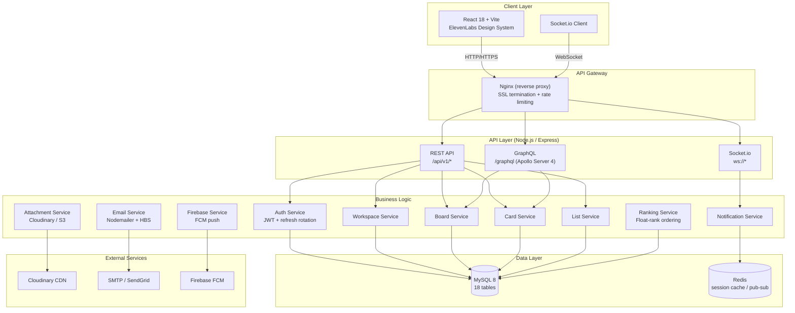
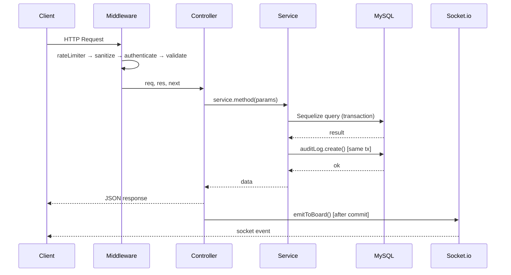

# Architecture — TaskFlow SaaS

## System Overview



## Directory Structure

```
p16-saas-task-manager/
├── .github/                    # GitHub Actions, templates, Dependabot
├── .husky/                     # Git hooks (pre-commit, commit-msg)
├── docs/                       # Architecture, ER diagram, security docs
├── server/                     # Node.js / Express API
│   ├── src/
│   │   ├── config/             # env, database, logger, mailer, cloudinary
│   │   ├── constants/          # roles, events, actions enums
│   │   ├── controllers/        # HTTP handlers (thin layer)
│   │   ├── graphql/            # Apollo Server, typeDefs, resolvers, loaders
│   │   ├── jobs/               # node-cron background jobs
│   │   ├── middleware/         # auth, validate, sanitize, rate-limit, upload
│   │   ├── migrations/         # Sequelize migrations (11 files)
│   │   ├── models/             # Sequelize models (18 tables)
│   │   ├── permissions/        # RBAC permission map + authorize middleware
│   │   ├── realtime/           # Socket.io handlers + emitter
│   │   ├── routes/             # Express routers
│   │   ├── seeders/            # Demo data seeds
│   │   ├── services/           # All business logic
│   │   ├── storage/            # Cloudinary / S3 adapters
│   │   ├── templates/          # Handlebars email templates
│   │   ├── utils/              # AppError, asyncHandler, jwt, hash, pagination
│   │   ├── validators/         # Joi schemas
│   │   ├── app.js              # Express app setup
│   │   └── server.js           # HTTP server + graceful shutdown
│   ├── tests/
│   │   ├── integration/        # Supertest API tests
│   │   ├── unit/               # Unit tests for services/utils
│   │   └── security/           # SQLi, rate-limit, upload-spoof tests
│   ├── Dockerfile              # Multi-stage production image
│   ├── package.json
│   └── .env.example
├── client/                     # React 18 + Vite frontend (Phase 15)
│   ├── src/
│   │   ├── assets/             # Static assets
│   │   ├── components/         # Shared UI components
│   │   ├── features/           # Feature-based modules
│   │   ├── hooks/              # Custom React hooks
│   │   ├── pages/              # Route-level page components
│   │   ├── stores/             # Zustand state stores
│   │   ├── styles/             # Global styles + design tokens
│   │   └── utils/              # Frontend utilities
│   ├── package.json
│   └── vite.config.js
├── docker-compose.yml          # Dev environment (MySQL + Redis + API + Client)
├── docker-compose.test.yml     # Test environment
└── README.md
```

## Request Lifecycle



## API Versioning

All REST endpoints are under `/api/v1/`. GraphQL is at `/graphql`. Socket.io at root WebSocket upgrade.

## Error Response Envelope

```json
{
  "success": false,
  "message": "Human-readable error message",
  "code": "ERROR_CODE",
  "errors": [],
  "requestId": "uuid"
}
```

## Success Response Envelope

```json
{
  "success": true,
  "message": "Operation description",
  "data": {},
  "meta": {
    "page": 1,
    "perPage": 20,
    "total": 100,
    "totalPages": 5
  }
}
```
