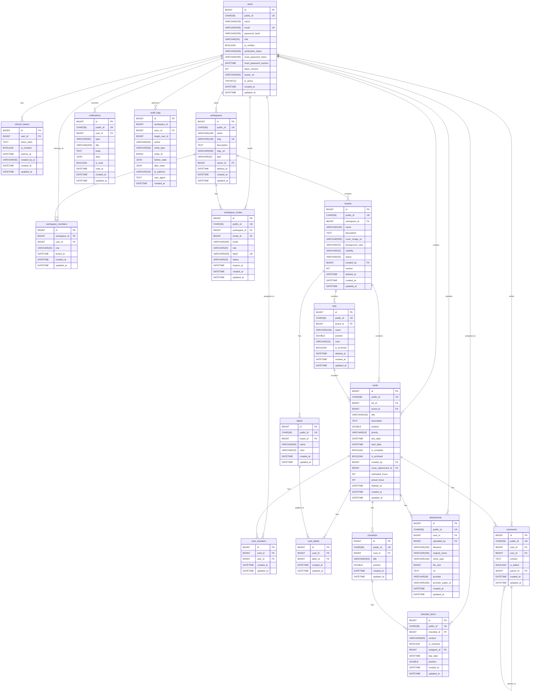

# Database Schema — Entity Relationship Diagram

TaskFlow uses **MySQL 8** with **Sequelize 6**. All tables use `BIGINT UNSIGNED AUTO_INCREMENT` as internal primary key and `CHAR(36)` UUID v4 as the public-facing identifier.

## ER Diagram



## Table Descriptions

| Table | Rows Est. | Description |
|-------|-----------|-------------|
| `users` | 10K+ | App users. `role` = `user` or `admin`. Soft-delete via `is_active`. |
| `refresh_tokens` | 50K+ | JWT refresh token store. `token_hash` = SHA-256 of raw token. Reuse detection: revoke all on reuse. |
| `workspaces` | 1K+ | Multi-tenant root. Paranoid (soft delete). `slug` auto-generated from name. |
| `workspace_members` | 20K+ | Pivot: user ↔ workspace. `role` = `owner`/`admin`/`member`. |
| `workspace_invites` | 5K+ | Email invites. `status` = `pending`/`accepted`/`declined`/`expired`. |
| `boards` | 10K+ | Kanban board. Paranoid. `visibility` = `private`/`workspace`/`public`. |
| `lists` | 100K+ | Columns within a board. Float-rank `position`. Paranoid. |
| `cards` | 1M+ | Tasks/tickets. Float-rank `position` within list. Paranoid. |
| `card_members` | 5M+ | Assignees pivot. |
| `labels` | 50K+ | Board-scoped labels. |
| `card_labels` | 500K+ | Label ↔ card pivot. |
| `checklists` | 500K+ | Sublists within a card. Float-rank `position`. |
| `checklist_items` | 5M+ | Individual checklist todos. |
| `attachments` | 2M+ | File uploads (Cloudinary/S3). `provider_public_id` for CDN management. |
| `comments` | 10M+ | Threaded comments. `parent_id` = NULL for top-level. |
| `notifications` | 100M+ | In-app notifications. `data` = JSON payload for deep links. |
| `audit_logs` | 500M+ | Append-only audit trail. No FK on `workspace_id` (allows workspace_id=0 for bootstrap). |

## Indexes

### High-Priority Indexes (covering queries from the app)

```sql
-- users
CREATE UNIQUE INDEX idx_users_public_id ON users(public_id);
CREATE UNIQUE INDEX idx_users_email ON users(email);

-- refresh_tokens
CREATE INDEX idx_refresh_tokens_user_id ON refresh_tokens(user_id);

-- workspaces
CREATE UNIQUE INDEX idx_workspaces_slug ON workspaces(slug);
CREATE INDEX idx_workspaces_owner_id ON workspaces(owner_id);

-- workspace_members
CREATE UNIQUE INDEX idx_wm_workspace_user ON workspace_members(workspace_id, user_id);
CREATE INDEX idx_wm_user_id ON workspace_members(user_id);

-- boards
CREATE INDEX idx_boards_workspace_id ON boards(workspace_id);
CREATE INDEX idx_boards_created_by ON boards(created_by);

-- lists
CREATE INDEX idx_lists_board_id ON lists(board_id);
CREATE INDEX idx_lists_position ON lists(board_id, position);

-- cards
CREATE INDEX idx_cards_list_id ON cards(list_id);
CREATE INDEX idx_cards_board_id ON cards(board_id);
CREATE INDEX idx_cards_position ON cards(list_id, position);
CREATE INDEX idx_cards_due_date ON cards(due_date, is_complete);
CREATE INDEX idx_cards_created_by ON cards(created_by);

-- card_members
CREATE UNIQUE INDEX idx_cm_card_user ON card_members(card_id, user_id);
CREATE INDEX idx_cm_user_id ON card_members(user_id);

-- labels
CREATE INDEX idx_labels_board_id ON labels(board_id);

-- card_labels
CREATE UNIQUE INDEX idx_cl_card_label ON card_labels(card_id, label_id);

-- checklists
CREATE INDEX idx_checklists_card_id ON checklists(card_id);

-- checklist_items
CREATE INDEX idx_ci_checklist_id ON checklist_items(checklist_id);

-- attachments
CREATE INDEX idx_attachments_card_id ON attachments(card_id);

-- comments
CREATE INDEX idx_comments_card_id ON comments(card_id);
CREATE INDEX idx_comments_parent_id ON comments(parent_id);

-- notifications
CREATE INDEX idx_notifications_user_id ON notifications(user_id, is_read, created_at);

-- audit_logs
CREATE INDEX idx_audit_workspace ON audit_logs(workspace_id, created_at);
CREATE INDEX idx_audit_actor ON audit_logs(actor_id);
CREATE INDEX idx_audit_entity ON audit_logs(entity_type, entity_id);
```

