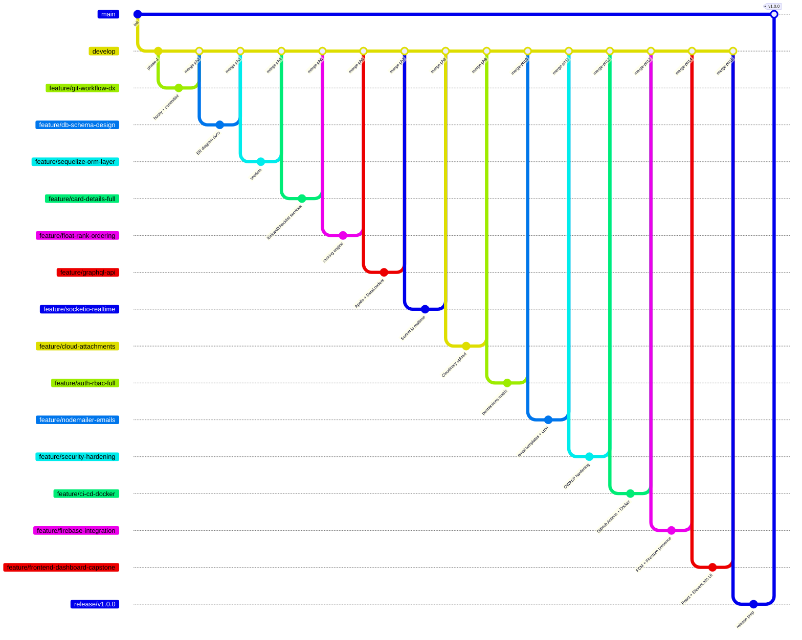

# Git Workflow — TaskFlow SaaS

This project uses a **GitHub Flow** variant with protected branches and Conventional Commits.

## Branch Strategy



## Branch Naming

| Branch | Purpose |
|--------|---------|
| `main` | Production-ready, tagged releases only |
| `develop` | Integration branch, always green |
| `feature/<name>` | New features (from develop) |
| `fix/<name>` | Bug fixes (from develop or main) |
| `hotfix/<name>` | Emergency fixes (from main) |
| `release/<version>` | Release stabilization (from develop) |
| `chore/<name>` | Maintenance tasks |

## Commit Message Convention

We use [Conventional Commits](https://www.conventionalcommits.org/):

```
<type>(<scope>): <short summary>

[optional body]

[optional footer(s)]
```

### Types

| Type | When to use |
|------|-------------|
| `feat` | New feature |
| `fix` | Bug fix |
| `docs` | Documentation only |
| `style` | Formatting, missing semicolons, etc. |
| `refactor` | Code restructure, no behavior change |
| `perf` | Performance improvement |
| `test` | Adding or fixing tests |
| `chore` | Build system, CI, dependencies |
| `revert` | Revert a previous commit |

### Scopes

`auth`, `workspace`, `board`, `card`, `list`, `checklist`, `label`, `comment`, `attachment`, `notification`, `graphql`, `socket`, `email`, `firebase`, `ci`, `docker`, `ui`, `deps`

### Examples

```bash
feat(card): add due date reminder notifications
fix(auth): handle expired refresh token edge case
docs(api): add GraphQL schema documentation
chore(deps): bump sanitize-html to 2.12.1
test(board): add RBAC integration tests
```

## PR Workflow

1. Branch off `develop`: `git checkout -b feature/<name>`
2. Make commits (Commitlint enforced via husky)
3. Push and open PR to `develop`
4. CI must pass (lint + tests + coverage ≥70%)
5. At least 1 review required (CODEOWNERS enforced)
6. Squash & merge (default)
7. Delete feature branch after merge

## Protected Branch Rules

### `main`
- Require PR reviews (2 minimum)
- Require status checks: `ci/test`, `ci/lint`, `ci/build`
- No force push
- No direct commits

### `develop`
- Require PR reviews (1 minimum)
- Require status checks: `ci/test`, `ci/lint`
- No force push

## Hooks (via Husky)

| Hook | Action |
|------|--------|
| `pre-commit` | `lint-staged` (ESLint + Prettier) |
| `commit-msg` | `commitlint` (enforces Conventional Commits) |

## Release Process

1. Create `release/vX.Y.Z` from `develop`
2. Bump version in `package.json`, update `CHANGELOG.md`
3. PR to `main` — requires 2 reviews
4. Tag: `git tag -a vX.Y.Z -m "Release vX.Y.Z"`
5. Push tag, GitHub Actions publishes Docker image + creates GitHub Release
6. Back-merge `main` into `develop`

